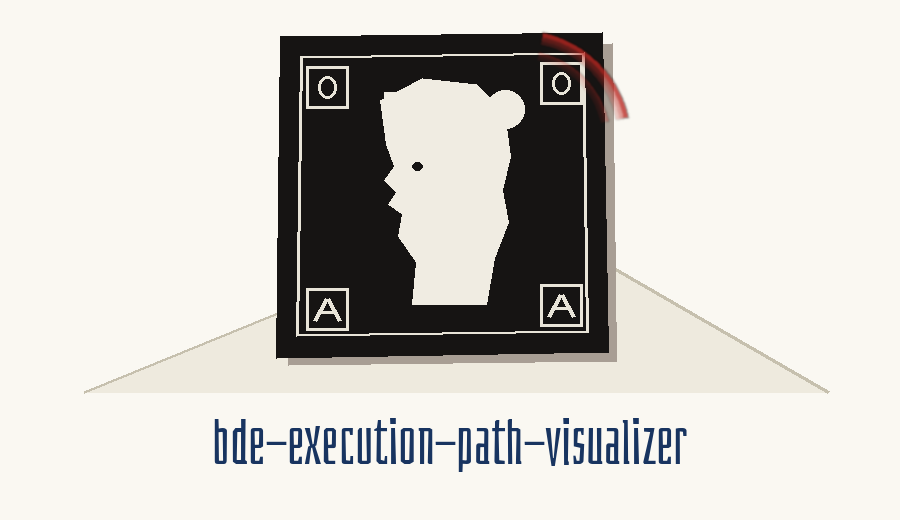

# bde-Execution-Path-Visualizer

A command-line tool that writes a Graphviz dot file listing the call shaped names found in a script, as a flat list of edges from one MainScript node. There is no branching or control flow structure in the output: the name matcher also picks up keywords, so words such as `if` and `for` appear in the list as if they were calls, and no function definitions, conditions, or branch targets are represented. Optional steps before listing are jsbeautifier formatting, string decoding, and renaming underscore variables. String decoding covers base64 in the Python `b'...'` literal shape, and hex only inside a quoted `0x` literal such as `'0x41'`; numeric literals outside quotes are left alone. The script being listed is read as text and never run.

> **Postmarked note: no branches are drawn.** There is no branching or control flow structure in the output, and no function definitions, conditions, or branch targets are represented.

> **Postmarked note: keywords are listed as if they were calls.** The name matcher also picks up keywords, so words such as `if` and `for` appear in the list as if they were calls.

> **Postmarked note: the unexplained switch.** `-o` is listed with no description provided. This document does not guess that it names the output dot file.

## Install
`git clone https://github.com/ShadowStrikeHQ/bde-execution-path-visualizer`

## Usage
`./bde-execution-path-visualizer [params]`

## Parameters
- `-h`: Show help message and exit
- `-o`: No description provided
- `-v`: Enable verbose logging
- `--beautify`: Beautify the input script before analysis.
- `--decode_strings`: Attempt to decode encoded strings: base64 in the Python `b'...'` literal shape, and hex only inside a quoted `0x` literal such as `'0x41'`. Numeric literals such as `0x10` outside quotes are left alone.
- `--rename_variables`: Attempt to rename obfuscated variables.

## License
Copyright (c) ShadowStrikeHQ
